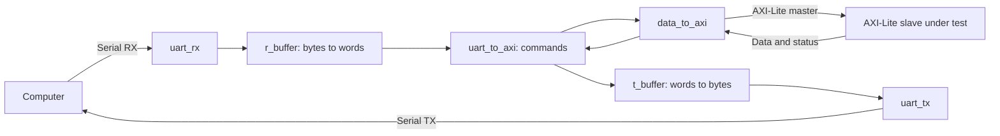

# UART → AXI-Lite debug bridge

This directory contains an AXI-Lite master controlled by binary commands received
over UART. A computer can read or write an AXI-Lite module's registers without
an embedded processor. The reusable component is **`uart_to_axi`**; it does not
depend on the DRAM cache, MIG or ADAM.

For integration and a host script, start with [QUICKSTART.md](QUICKSTART.md).
New commands and their formats are defined in
[docs/PROTOCOL.md](docs/PROTOCOL.md). Current results are recorded in
[docs/VALIDATION.md](docs/VALIDATION.md).

The legacy commands described below are preserved. Extensions add masked writes,
raw statuses, identification and AXI-Lite blocks of 1 to 256 words. The top retains
all its ports and parameters.

## Organization and required sources

Synthesizable SystemVerilog sources are in `src/`. Simulation-only MIG and clock
models stay in `cache_integration/rtl/` and must not be used in physical builds.

| File | Responsibility |
|---|---|
| `src/uart_rx.sv` | Synchronize RX and decode serial frames; report framing and overrun errors |
| `src/r_buffer.sv` | Assemble four bytes into a 32-bit word |
| `src/uart_to_axi.sv` | Decode commands, sequence accesses and construct responses |
| `src/data_to_axi.sv` | Capture operands and drive the five AXI-Lite channels |
| `src/t_buffer.sv` | Split response words into bytes |
| `src/uart_tx.sv` | Transmit serial frames |
| `src/fifo.sv` | FIFO used by the `top_uart` demonstration |
| `src/top_uart.sv` | Demonstration that receives and retransmits a burst; no AXI accesses |
| `src/uart_to_cache.sv` | Board top: serial bridge, cache, MIG, clocks and LEDs |

To integrate only the bridge, compile the **first six files** in the table, with
`uart_to_axi` as the top. `fifo` is not part of the bridge datapath.
The protocol requires `ADDR_WIDTH=32`, `DATA_WIDTH=32` and
`UART_DATA_WIDTH=8`; an RTL assertion rejects other values.

By default, `top_uart` waits for three 128-bit words, or 48 bytes, before
retransmitting them. Its FIFO rejects writes when full and reads when empty,
even if the opposite operation is presented simultaneously. The top's tests
reduce words to 32 bits, so their bursts contain twelve bytes.

Both demonstrations have an **active-low** `sys_rst` input, unlike the bridge
blocks' active-high `rst`. `uart_to_cache` depends on `../src/`, MIG and the
clock wizard; it provides the `cycle_ct` counter, a lock LED and an LED latching
an RX error. It is not part of the standalone component.



## Wire protocol

### UART and word representation

The protocol uses **8N1**: idle high, one low start bit, eight data bits sent
LSB-first and one high stop bit, without parity. The 32-bit words are sent
**least significant byte first**. Addresses and data are binary: do not send a
hexadecimal string or append carriage returns or line feeds. Each extra byte
would be interpreted as part of the next word.

`CLOCKS_PER_BIT = CLK_FREQ / BAUD_RATE` uses integer division. Supply the actual
`clk` frequency and allow at least four cycles per bit. The effective baud rate
is `CLK_FREQ / CLOCKS_PER_BIT`. The bridge defaults to 100 MHz and 115200 baud;
the cache demonstration configures it for the 50 MHz CPU clock.

### Commands and responses

| Command, ASCII bytes | Following binary payload | Normal response | AXI access |
|---|---|---|---|
| `CMDA` | None | Four bytes `RESP` | None |
| `TEMP` | None | 32-bit value of the `cycle_ct` input, little endian | None |
| `WRIT` | 32-bit address, then 32-bit data | Four bytes `OKAY` or `ERR!` | One write |
| `READ` | 32-bit address | 32-bit data, then four bytes `OKAY` or `ERR!` | One read |
| Any other word except extension commands | None | Four bytes `????` | None |

`TEMP` does not measure temperature: it reads the counter supplied by the
integrating design. The bridge does not create this counter itself.

AXI status `00` becomes `OKAY`. Every other status becomes `ERR!`, so the legacy
serial protocol does not distinguish SLVERR from DECERR. For `READ`, the four
data bytes are transmitted even when the status indicates an error; their
validity depends on the slave module. The host must consume all eight bytes and
check the status before using the data.

Example: writing `0xDEADBEEF` to AXI address `0x00001000`:

```text
Request: 57 52 49 54  00 10 00 00  EF BE AD DE
          W  R  I  T    address       data
Success: 4F 4B 41 59                            (OKAY)

Readback: 52 45 41 44  00 10 00 00             (READ + address)
Response: EF BE AD DE  4F 4B 41 59             (data + OKAY)
```

In Python, requests can be built with
`b"WRIT" + struct.pack("<II", address, value)` and
`b"READ" + struct.pack("<I", address)`, for example.

The host must **send one complete command and wait for its complete response**
before sending another. There is no command identifier, packet-length envelope,
CRC or RTS/CTS. The theoretical minimum READ/WRIT round-trip wire time at
115200 baud is approximately 1.39 ms for sixteen bytes, plus internal and AXI waits.

## RTL operation

### Reception, assembly and transmission

`uart_rx` synchronizes the RX pin through two registers, detects the start
condition, verifies the level halfway through the start bit, then samples each
data bit and the stop bit. It does not use majority voting. A **one-byte** mailbox
retains the result while `mst_valid=1` and `mst_ready=0`.

- A low stop bit produces a `framing_error_o` pulse; the faulty byte is not delivered.
- A new valid frame while the mailbox is occupied produces `overrun_error_o`;
  the previous byte is retained.

`r_buffer` receives bytes through a handshake, places them successively in
`[7:0]`, `[15:8]`, `[23:16]`, `[31:24]`, then holds the word and `mst_valid`
until acceptance. It rejects further fragments while the word is pending.
Disabling it with `enable=0` clears its state on the clock edge.

`t_buffer` captures a word on `slv_valid && slv_ready`, then emits its fragments
in the corresponding order, again least significant first.
`uart_tx` captures each accepted byte and transmits start, data and stop bits;
changing the input after acceptance does not alter the frame in progress.
Streaming interface VALID signals and payloads are retained under backpressure.

### Command decoder

The legacy `uart_to_axi` state-machine paths are:

- `WRIT`: `Command → WriteAddress → WriteData → StartWrite → WaitWrite → SendStatus`.
- `READ`: `Command → ReadAddress → StartRead → WaitRead → SendData → SendStatus`.
- `CMDA`, `TEMP` or an unknown command: `Command → SendStatus`.

Addresses and data are stored before starting the AXI access. The write response
is constructed after `write_done`. The read response contains `read_data` first,
then status. Transitions between sending states happen when `t_buffer` accepts
a word, not when its bytes have finished transmitting on the wire.
This does not authorize the host to pipeline commands.

The first framing or overrun error latches `rx_fault_q`, requests transmission
of `ERR!` (further errors are ignored until reset), then places the decoder in
`Fault`. New commands are blocked until reset. This protects against executing
a stream that has lost word alignment; `rx_error_o` remains asserted.
The error does not cancel an AXI transaction already started and does not
guarantee that no write occurred. Recovery without reset is not implemented.
Tests cover a fault while idle and while waiting for an AXI B response. A fault
during a serial response may leave an already transmitted prefix followed by
`ERR!`; normal response framing no longer applies and reset remains mandatory.

### `data_to_axi` engine

This module has two independent state machines: a read and a write may be active
simultaneously when it is driven directly. The UART decoder uses them sequentially.

| Path | Behavior |
|---|---|
| Write start | Capture `w_addr` and `w_data` in `WriteIdle` when `start_write` is asserted |
| AW/W | Drive the two channels independently; retain whichever still awaits READY |
| B | Wait for the response after AW and W acceptance; capture `BRESP` |
| Write completion | Hold `write_done` and `write_status` until `write_receive` |
| Read start | Capture `r_addr` in `ReadIdle` when `start_read` is asserted |
| AR/R | Hold AR until acceptance, then wait for and capture `RDATA/RRESP` |
| Read completion | Hold `read_done`, data and status until `read_receive` |

A direct caller must pulse start when a path is available and acknowledge each
result before restarting that path. There is no `command_ready` signal; a start
presented while busy is ignored, and a held start may be reinterpreted when the
path becomes available again.

`data_to_axi` drives all its strobes to 1. In `uart_to_axi`, a stored mask applies
the `WMSK` strobes; legacy commands and blocks continue to write complete words.
The bridge checks neither address alignment nor address range; those checks
belong to the slave or interconnect.

## Connecting an AXI-Lite module

Connect `clk` to the tested module's AXI clock and provide a local **active-high,
synchronous** `rst`. Connect RX/TX to the host UART. All bridge AXI signals are
in the `clk` domain; only RX has internal synchronization.
A slave in another clock domain requires an appropriate AXI CDC bridge.

| Bridge to slave | Slave to bridge |
|---|---|
| `axi_awaddr`, `axi_awvalid` | `axi_awready` |
| `axi_wdata`, `axi_wstrb`, `axi_wvalid` | `axi_wready` |
| `axi_bready` | `axi_bresp`, `axi_bvalid` |
| `axi_araddr`, `axi_arvalid` | `axi_arready` |
| `axi_rready` | `axi_rdata`, `axi_rresp`, `axi_rvalid` |

The bridge exposes the AXI-Lite subset needed for these transfers. It does not
generate AWPROT/ARPROT: tie them explicitly to suitable values if the slave
interface requires them. It is not a full AXI master: no bursts, IDs, AxLEN or
WLAST. A full AXI target requires an additional adapter.

There is **no AXI timeout**. A slave that does not accept a request or respond
blocks the command. A computer-side timeout does not cancel it.
Reset must be coordinated with the slave: it discards local states but cannot
undo an existing side effect. The debug tool must account for clear-on-read
registers and other accesses with side effects.

## Local Cocotb tests

### Contents and independence

The original tests remain under `../test/`. Local copies and their helpers are
in `tests/`. `tests/COPIED_FROM.json` records the paths and SHA256 values at copy
time. The copies may evolve for UART work; they are not automatically synchronized
with the originals. Run the suites separately to avoid Python module-name collisions.

`conftest.py` selects only the sources required by the DUT, passes parameters and
builds with Verilator through `cocotb_tools.runner`. **Ordinary tests compile no
sources from `../src`** and import no helpers from `../test`.
The directory can be copied elsewhere for bridge development, provided Verilator
and the Python environment are available.

| Test | Main scenarios | Pytest configurations |
|---|---|---:|
| `test_uart_rx.py` | All 256 bytes, small phase/baud differences, stalled data, bad stop, overrun | 1 |
| `test_uart_tx.py` | All 256 bytes, independent TX decoding, input capture, start/stop and idle | 1 |
| `test_r_buffer.py` | Fragment order, words held under backpressure, disable | 3: 32/8, 16/4, 8/8 bits |
| `test_t_buffer.py` | Words accepted once, fragment order, pauses and disable | 3: same widths |
| `test_fifo.py` | Deque oracle, capacity, full/empty, wrap, simultaneous operations, reset | 5: depths 1/2/3/16/256 |
| `test_data_to_axi.py` | Concurrent read/write, operands changed after capture, delayed B, statuses 0/2/3, held results | 1 |
| `test_uart_to_axi.py` | Complete serial dialogue, legacy and extended commands, AXI errors, framing faults, reset | 1 |
| `test_top_uart.py` | Two twelve-byte bursts retransmitted in order, depth-3 FIFO | 1 |

Helpers are intentionally simple:

- `serial_link.py` generates and decodes 8N1 frames at the pins. The reference
  decoder does not use our `uart_rx` RTL, avoiding a simple loopback in which
  two defects could compensate for each other. Start the test receiver **before**
  sending a command so that it does not miss the response start.
- `axi_lite_slave.py` provides an independent memory slave with variable READY,
  separate AW and W, a B response delayed by eight cycles and status injection.
  Its seed is 2026. `events` records requests and the `completed_*` counters count
  accepted responses.

The AXI model is word-addressed memory without peripheral decoding or alignment
checks. A missing read returns `0x12345678`. It applies byte strobes and writes
its memory even when a B error was requested. Tests cover all 16 masks; the model
does not provide an oracle for the absence of side effects on an error.

### Accelerated test clock

Serial tests use a **10 ns** Cocotb clock with RTL parameters
`CLK_FREQ=8_000_000` and `BAUD_RATE=1_000_000`. This gives eight cycles per bit,
so the **simulated bit time is 80 ns**, as used in `serial_link.py`.
The simulated physical baud rate is therefore not 1 Mbaud: these parameter values
obtain the desired divider and speed up tests.
If the ratio or clock period changes, update the configured RTL, the serial
model's bit time and testbench timeouts together.

### Running in Docker

From the parent repository root or this directory:

```bash
# Complete local suite, without the cache or FPGA board.
./uart_src/test_docker.sh

# From uart_src: target the serial protocol or AXI engine.
./test_docker.sh -q tests/test_uart_to_axi.py
./test_docker.sh -q tests/test_data_to_axi.py
```

The first command assumes the caller is at the parent root; from `uart_src`,
use `./test_docker.sh` instead. Test-selection arguments are relative to the
project root inside the container. `-s` displays simulator logs.

The launcher reuses `cache_design`. The current project directory is mounted
directly at `/phinaow`, which is also the test working directory.
It neither builds an image nor creates a container.
For a relocated directory, set `UART_CONTAINER_ROOT` to its container path;
`UART_CONTAINER_NAME` selects another container.
Check the existing container with `docker ps -a --filter name=cache_design`
before preparing an environment.

Python is selected from `/opt/cache-venv/bin/python`, then the container-created
`/phinaow/.venv/bin/python`, then `/tmp/cache-cocotb-venv/bin/python`. Dependencies
are in `requirements.txt`. The current `docker.sh`/`.bashrc` setup creates `.venv`
using the container Python. The test launcher reuses it without starting a login
shell, installing packages or rebuilding the image.
The container Python needs its shared library; `python -m find_libpython` must
return an existing file, exported as `LIBPYTHON_LOC`. Do not substitute a venv
created with an incompatible host Python for the container-created `.venv`.

In a **container** shell with the selected environment activated and the UART
directory as the working directory, the equivalent command is:

```bash
export PYTHONPATH="$PWD/tests:$PWD"
export LIBPYTHON_LOC="$(python -m find_libpython)"
python -m pytest -c pytest.ini -q tests
```

The configuration retains RTL assertions, VCD/struct tracing, the C++ `VM_TRACE`
options required by this version and the project's existing `-Wno-MULTIDRIVEN`.
No new warning suppression is added. Binaries, XML and `dump.vcd` files are
isolated by top/parameters under `sim_build/tests/<top>_<configuration>/`.
Git ignores these artifacts.

### Optional cache integration

`cache_integration/test_uart_to_cache.py` was also copied, along with its two
MIG/clock-wizard RTL models. It checks serial pins → cache → simulated memory,
twelve lines causing evictions and address errors. The extended test also covers
masked writes and 256-word blocks.

```bash
./test_docker.sh -q cache_integration
```

This command requires the cache in `../src/`, including `../src/cache.f`.
The default Docker mount exposes only this UART project, so the parent cache is
not available in that container. To run this optional test, use a container that
also mounts the parent cache with the expected sibling layout; set
`UART_CONTAINER_NAME` and `UART_CONTAINER_ROOT` accordingly (for the old parent
mount, the UART root was `/phinaow/uart_src`).
It is excluded from the default suite through `testpaths = tests`.
The clock model does not synthesize frequencies, and the MIG model is not an
electrical DDR3 model. **Never include these models in a physical build.**
This test may be omitted when extracting the directory for standalone UART work.

## Historical results and initial next steps

The following section describes the initial preparation. For implemented
extensions and current limitations, see [docs/VALIDATION.md](docs/VALIDATION.md).

On October 22, 2026, the local suite passed **16 pytest cases** with Cocotb 2.0.1,
pytest 9.1.1 and Verilator 5.053 devel (`v5.052-537-g2fa781df8`). The log is
`sim_build/regression.log`. The optional cache integration test also passed
(**1 pytest case**), with its own log at `sim_build/cache_integration.log`.
A copy of the directory without the cache or parent tests also passed the two
central tests, `uart_to_axi` and `data_to_axi`; log: `sim_build/standalone.log`.

Those results do not exhaustively cover baud tolerance, metastability, serial
errors during an active AXI transaction, all resets during transfers or a slave
that never responds. Verilator simulation is two-state. Creating this working
directory involved no new physical or hardware validation.

The initial recommendations for turning the bridge into a reusable debug tool were:

1. Start with the six sources and `test_uart_to_axi.py`, then replace the Python
   slave with a wrapper for the AXI-Lite module under test. Preserve AXI request
   observation and exact serial-response comparisons.
2. Extend reset and stall tests before adding a timeout. Define what happens to
   an already accepted AXI request: an expired deadline does not cancel it.
3. If needed, specify masked writes, exact AXI status reporting and a
   resynchronization procedure. Preserve existing command compatibility or
   explicitly version the protocol.
4. Then build a generic host client with exact response reads, error handling
   and named register access. The existing `../scripts/test_board.py` illustrates
   encoding, but its campaign writes DDR and must not be used unchanged on an
   arbitrary peripheral.

Local working instructions are in [AGENTS.md](AGENTS.md).
